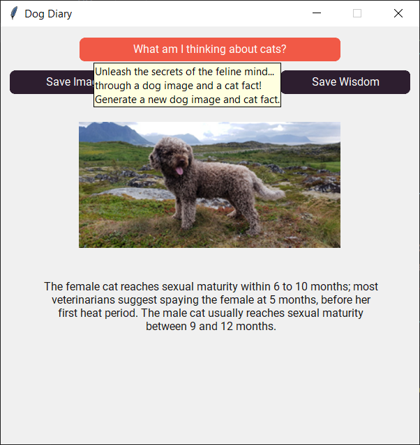
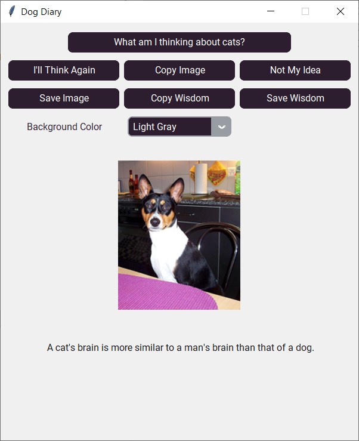
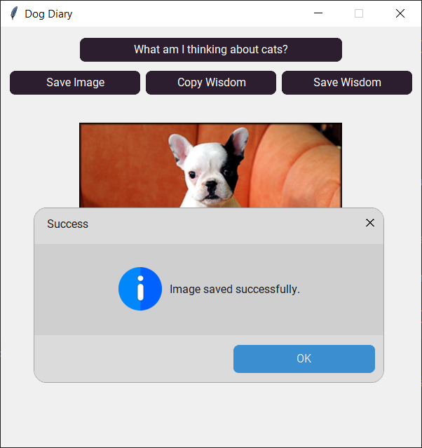
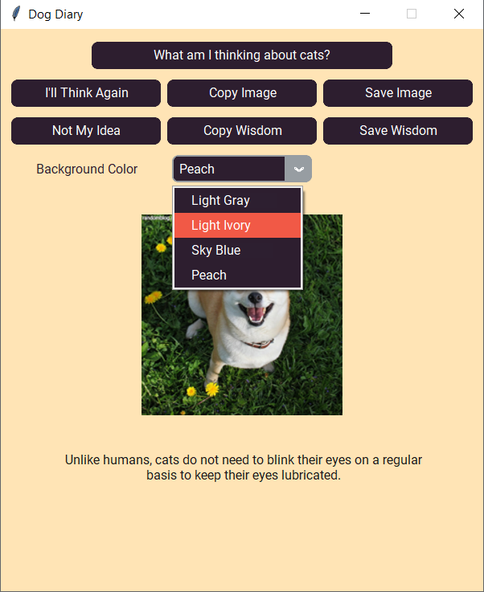
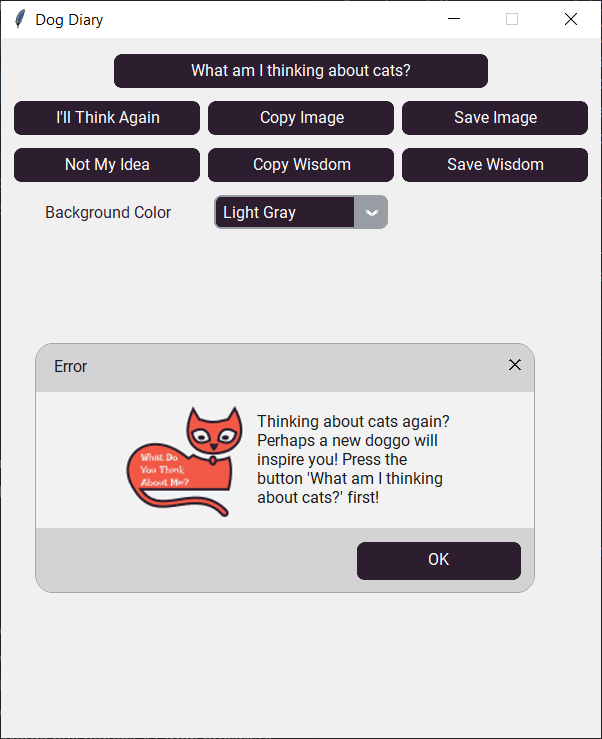
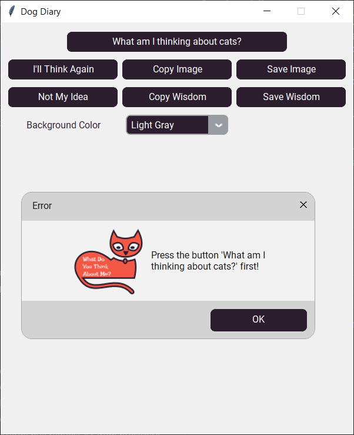

# Dog Diary

  
  
  
  
  
  
   

  
  
  
  
  
   

  
  
  
  

Woof! This app 🐶🐾🐶 is a paw-some way to see adorable doggos and discover fun facts about their feline friends.
Based on Cat Facts API: https://catfact.ninja/fact and on Dog API: https://dog.ceo/api/breeds/image/random

## Introduction
The "Dog Diary"  application is a fun and simple app designed for dog and cat lovers 💕💘. It combines adorable dog images with interesting cat facts. The app utilizes two publicly available APIs:

- dog.ceo: This API provides random images of various dog breeds.
- catfact.ninja: This API offers a database of interesting and lesser-known facts about cats.

## Who is this for?
- Animal lovers: If you can't get enough of dogs and cats, this app is for you.
- Mood boosters: Need a quick pick-me-up? Our app is guaranteed to put a smile on your face.
- Anyone who loves fun: If you're looking for a fun and easy way to pass the time, look no further!

## Functionality
- Displays random dog images: Clicking the "What am I thinking about cats?" button will display a random image of a dog.

  

- Displays cat facts: Along with the dog image, a fun fact about cats is presented.

  
  
- Saves images: Users can save their favorite dog images to their local device.

  

## How to Change the Background Color

- Locate the "Background Color" label and the adjacent dropdown menu in the button section of the application.
- Click on the dropdown menu to reveal the list of available colors.
- Select your desired color from the list. The application's background will immediately update to reflect your choice.

   

## Handling Empty Content for Buttons

The application handles situations where the user clicks buttons for working with images or text before any content (dog image or cat fact) has been loaded. In these cases, an information message box is displayed with a warning. Specifically:

- **"I'll Think Again"** - If the user clicks this button before the first cat fact is displayed (i.e., when wisdom_label is empty), a message box appears saying, "Thinking about cats again? Perhaps a new doggo will inspire you! Press the button 'What am I thinking about cats?' first!"

  
  
- **"Not My Idea" Button** - If the user clicks this button before the first cat fact is displayed (i.e., when wisdom_label is empty), a message box appears saying, "Press the button 'What am I thinking about cats?' first!"

  

## Code Breakdown:

1. Imports: Necessary libraries for GUI elements, network requests, image processing, and clipboard interaction are imported.
2. DogImageApp Class:
    -  init(): Initializes the application window with title, size, and disables resizing. Creates frames and buttons with descriptive text. Assigns tooltips to buttons using the Hovertip class.
    -  show_dog_and_wisdom(): Fetches a random dog image URL and cat fact concurrently using requests. Handles potential errors gracefully and updates labels with informative messages.
    -  show_dog_image(image_url): Downloads and displays the dog image at the given URL. Implements error handling for download failures.
    -  show_wisdom(wisdom_text): Formats and displays the provided cat fact text in the wisdom label.
    -  save_image(): Saves the currently displayed dog image to a user-chosen location. Handles potential saving errors.
    -  copy_wisdom_to_clipboard(): Copies the displayed cat fact text to the system clipboard.
    -  save_wisdom(): Saves the displayed cat fact to a user-chosen text file. Handles potential file operation errors.
4. Main Loop: If the script is executed directly, it creates an instance of the DogImageApp class and starts the main application loop (mainloop).

## Author
Lovingly crafted by [Hanka Robovska](https://github.com/hrosicka)

## License
This project is licensed under the MIT License. See the [LICENSE](./LICENSE) file for details. Free to use, modify, and distribute as needed.
